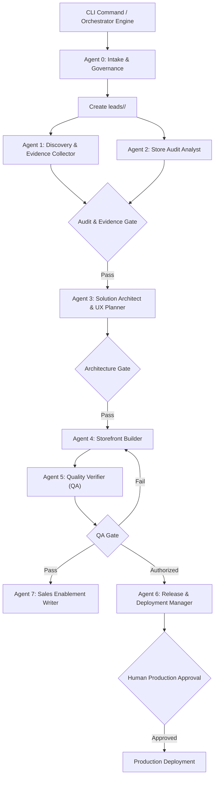

# 📖 Global Shopify Modernization Agency Orchestrator — Full Documentation

## 1. Executive Summary & Vision

The **Global Shopify Modernization Agency Orchestrator** is an enterprise-grade agentic workflow system designed to automate the end-to-end lifecycle of modernizing and migrating Shopify e-commerce businesses to high-performance, independent, proprietary web architectures (such as Next.js, Tailwind CSS, headless commerce, and localized Cash-on-Delivery engines).

While universally applicable to any Shopify merchant worldwide, it is particularly optimized for high-friction emerging markets such as **Morocco**, where merchants face unique systemic constraints:
- **Dotation E-commerce limits:** Foreign currency caps set by the Office des Changes, where recurring Shopify subscriptions ($39–$399/mo) and stacked Shopify app fees ($100–$300/mo in USD) deplete the merchant's international card quota, directly starving their Meta and TikTok ad budgets.
- **The 2.0% transaction penalty:** Shopify imposes an extra 0.5% to 2.0% fee on every Cash-on-Delivery (COD) or local CMI credit card order because native *Shopify Payments* is unavailable in Morocco.
- **Mobile checkout abandonment:** Default 3-step Shopify checkouts demand postal codes and redundant fields, alienating mobile shoppers and slowing down page speed over 4G connections.

The Orchestrator coordinates **8 specialist subagents** bound by a strict **evidence-based contract**, ensuring every audit claim, performance measurement, cost calculation, and code artifact is strictly verified before reaching human decision-makers.

---

## 2. Core Operating Principles

1. **Evidence Before Claims:** Every audit finding must record its source URL, collection timestamp, testing method, and confidence score. Speculative metrics are strictly forbidden.
2. **Approval Before External Change:** No cloud project, database, repository, domain DNS change, or prospect outreach is executed without explicit human authorization.
3. **Public Data Only by Default:** Respect robots directives, rate limits, intellectual property, and terms of service. Never bypass authentication or anti-bot mechanisms.
4. **Demo Safety:** Speculative prototypes must be explicitly watermarked as private proposals. Never impersonate the prospect or process live transactions.
5. **Zero Secrets in Artifacts:** API keys, database passwords, and service tokens are kept exclusively in environment variables or secret managers, never in version control or lead files.
6. **Mandatory Quality Gates:** A stage advances only when all criteria pass. Any gate failure returns the work to the responsible specialist agent.
7. **Human-in-the-Loop:** Automated agents draft research, code, cost models, and messages. Humans retain final approval for client contact, credential provisioning, and production deployment.
8. **Idempotency & Safe Resume:** Every stage records its status in `run.json`, enabling interrupted processes to resume seamlessly without duplicating external resources.

---

## 3. System Architecture & Specialist Agents



### Detailed Agent Specifications

| Agent | Subagent Identifier | Mission | Inputs & Evidence | Core Deliverables | Quality Gate |
| :--- | :--- | :--- | :--- | :--- | :--- |
| **Agent 0** | `intake_governance` | Establish scope, authority, risk level, and unique workspace | Store URL, Business Name, authorized mode | `lead.json`, `run.json` | Valid target URL, authorized mode, safe permission defaults |
| **Agent 1** | `discovery_collector` | Collect public brand identity, catalog samples, and contact channels | Public storefront, sitemap, meta tags, schema.org | `evidence/*`, `discovery/brand_dossier.json` | Completeness threshold met; missing items flagged `null` with rationale |
| **Agent 2** | `audit_analyst` | Conduct lab/field audits (speed, scripts, COD friction, costs) | Network waterfalls, DOM structure, script tracking | `audit/audit_report.json`, `audit_summary.md` | Median of multi-run tests; zero unsubstantiated cost/savings claims |
| **Agent 3** | `solution_architect` | Formulate tailor-made architecture, tokens, and bilingual UX | Brand dossier, audit findings, market norms | `solution/requirements.md`, `design_tokens.json`, `adr.md` | Requirements testable; explicit RTL/LTR specs; anti-fraud COD logic |
| **Agent 4** | `storefront_builder` | Build performant demo candidate (Next.js, Tailwind, Fast COD) | Architecture specs, design tokens, mock data | `demo/source/*` | Linting, strict TypeScript checks, unit tests, and production build pass |
| **Agent 5** | `quality_verifier` | Adversarial QA across viewport, network, RTL, and security | Demo source code, live preview endpoint | `demo/qa_report.json` | Zero critical/high defects; accessibility & performance budgets met |
| **Agent 6** | `release_manager` | Reversible release management using least privilege | Approved deployment plan, environment configs | `deployment/deployment_plan.json`, `manifest.json` | Staging preview verified; human approval recorded; smoke tests pass |
| **Agent 7** | `sales_writer` | Draft respectful, audit-backed sales outreach (FR & Darija) | Audit report, brand dossier, verified contacts | `sales/outreach_fr.md`, `sales/outreach_darija.md` | All claims trace to audit; zero false promises; opt-out included |

---

## 4. Workspace Directory Hierarchy

For every target business, the Orchestrator provisions an isolated, persistent directory named directly after the brand under `leads/<Business_Name>/`:

```text
leads/<Business_Name>/
├── lead.json                      # Master lead profile, metadata, and permissions
├── run.json                       # State machine status, stage history, and approvals
├── evidence/                      # Immutable raw HTTP dumps, screenshots, and SHA256 hashes
├── discovery/
│   └── brand_dossier.json         # Visual identity, typography, navigation, catalog sample
├── audit/
│   ├── audit_report.json          # Machine-readable PageSpeed, script drain, and friction logs
│   └── audit_summary.md           # Executive synthesis of findings and financial drain
├── solution/
│   ├── requirements.md            # Functional & non-functional requirements
│   ├── design_tokens.json         # Color palette, spacing, typography, RTL rules
│   ├── component_spec.md          # Specs for 1-Click COD checkout, WhatsApp handoff, etc.
│   └── architecture_decision_record.md # Key technical decisions (framework, database, host)
├── demo/
│   ├── source/                    # Complete Next.js / Tailwind demo codebase
│   └── qa_report.json             # Independent automated test and audit verification
├── deployment/
│   ├── deployment_plan.json       # Pre-deployment environment and infrastructure plan
│   └── deployment_manifest.json   # Release manifest with commit hashes and rollback guide
└── sales/
    ├── outreach_fr.md             # Personalized executive outreach in French
    └── outreach_darija.md         # Personalized conversational outreach in Moroccan Darija
```

---

## 5. State Machine & Execution Lifecycle

The workflow advances through well-defined sequential stages recorded in `run.json`:

```text
[INTAKE]
   │
   ▼
[DISCOVERY] ──► [AUDIT]
   │               │
   └───────┬───────┘
           ▼
      [SOLUTION]
           │
           ▼
        [BUILD]
           │
           ▼
         [QA] ──(Defects Detected)──► [BUILD]
           │
     (All Gates Passed)
           │
           ├────────────────────────┐
           ▼                        ▼
     [SALES DRAFT]          [PREVIEW DEPLOY]
           │                        │
           ▼                        ▼
     [HUMAN REVIEW]         [PROD APPROVAL]
           │                        │
           ▼                        ▼
       [OUTREACH]             [PROD DEPLOY]
           │                        │
           └───────────┬────────────┘
                       ▼
                  [COMPLETE]
```

### Stage Definitions in `run.json`

| Stage | Permitted Statuses | Transition Requirement |
| :--- | :--- | :--- |
| `intake` | `pending`, `running`, `passed`, `blocked` | Target URL verified and normalized; `lead.json` generated |
| `discovery` | `running`, `passed`, `failed` | Brand dossier compiled with verified source URLs and hashes |
| `audit` | `running`, `passed`, `failed` | Multi-sample lab & field audits finished without speculative claims |
| `solution` | `running`, `passed`, `blocked` | Requirements, tokens, and ADR documented and aligned with audit |
| `build` | `running`, `passed`, `failed` | Clean TypeScript build under `demo/source/` without build errors |
| `qa` | `running`, `passed`, `failed` | Independent test suite, RTL/LTR verification, and security scans pass |
| `deploy` | `pending`, `running`, `passed`, `blocked` | Explicit human authorization required for external cloud deployment |
| `sales` | `pending`, `running`, `passed` | Outreach drafted strictly from verified audit evidence |
| `complete` | `passed` | All stages satisfied and recorded |

---

## 6. Command Contract & CLI Reference

The orchestrator engine is invoked via `orchestrator.py`:

### Syntax & Available Commands

#### 1. Assess a Store
Initializes the workspace, creates `leads/<Business_Name>/`, verifies the URL, and launches discovery:
```bash
# Auto-detect business name from URL:
python orchestrator.py Assess https://anulus.ma

# Explicit business name:
python orchestrator.py Assess https://flexshoes.ma "Flex Shoes"
```

#### 2. Build Demo
Builds the scoped Next.js / Tailwind prototype inside `leads/<Business_Name>/demo/source/`:
```bash
python orchestrator.py "Build demo Flex_Shoes"
```

#### 3. Prepare Deployment
Generates the non-destructive deployment plan and checks environment variables:
```bash
python orchestrator.py "Prepare deployment Flex_Shoes"
```

#### 4. Deploy (Production / Preview)
Executes release only when `--approved` flag is present:
```bash
python orchestrator.py "Deploy Flex_Shoes --approved"
```

#### 5. Draft Outreach
Generates tailored French and Darija outreach scripts based on audit evidence:
```bash
python orchestrator.py "Draft outreach Flex_Shoes"
```

#### 6. Inspect Status & Pipeline
```bash
# Show state of a single business:
python orchestrator.py status Flex_Shoes

# List all tracked businesses in the workspace:
python orchestrator.py list
```

---

## 7. JSON Schemas & Validation

All JSON files adhere to strict JSON Schema specifications under [`schemas/`](file:///c:/Users/UserAdmin/Desktop/work/shopify/schemas/):

### `schemas/lead.schema.json`
Ensures every prospect maintains clean identity, geographic, and permission metadata:
- Required: `lead_id`, `target_url`, `mode`, `created_at`, `market`
- Permissions object: `asset_use` (bool), `data_collection` (bool), `deployment` (bool), `outreach` (bool). Default is strictly least-privilege.

### `schemas/run.schema.json`
Enforces the state machine integrity:
- Required: `lead_id`, `target_url`, `stage`, `status`, `started_at`, `updated_at`, `attempt`, `artifact_versions`, `approvals`, `blockers`, `next_action`.

### `schemas/handoff.schema.json`
Standardizes the output contract for all 8 specialist agents:
- Required: `status`, `summary`, `artifacts`, `evidence`, `assumptions`, `risks`, `blockers`, `gate_results`, `recommended_next_action`.

---

## 8. Financial Model: Shopify vs. Proprietary Stack

The orchestrator includes a battle-tested financial ROI model comparing the ongoing drain of Shopify against a high-performance custom stack:

$$\text{Annual Shopify Drain} = 12 \times \left( \text{Plan}_{\text{USD}} + \text{Apps}_{\text{USD}} \right) \times \text{Rate}_{\text{MAD}} + \left( \text{Revenue}_{\text{Annual}} \times \text{Fee}_{\text{Penalty}} \right)$$

### Typical Moroccan Merchant Profile (Example: 150,000 DH Monthly GMV)

| Cost Category | Shopify (Year 1) | Shopify (3 Years) | Proprietary Site (Year 1) | Proprietary Site (3 Years) |
| :--- | :---: | :---: | :---: | :---: |
| **Platform Subscription** ($39/mo $\times$ 10 MAD) | 4,680 DH | 14,040 DH | **0 DH** | **0 DH** |
| **Stacked Apps** (PageFly, COD, Judge.me ~ $80/mo) | 9,600 DH | 28,800 DH | **0 DH** (Native code) | **0 DH** |
| **Shopify 2.0% Transaction Penalty** ($150\text{k}\times 2\%$) | 36,000 DH | 108,000 DH | **0 DH** | **0 DH** |
| **Initial Build / Migration Fee** (One-time) | 0 DH | 0 DH | 18,000 DH | 18,000 DH |
| **Cloud Hosting** (Vercel / Hetzner ~ 100 DH/mo) | 0 DH | 0 DH | 1,200 DH | 3,600 DH |
| **TOTAL EXPENDITURE** | **50,280 DH** | **150,840 DH** | **19,200 DH** | **21,600 DH** |
| **NET SAVINGS FOR MERCHANT** | — | — | **+31,080 DH** | **+129,240 DH** |

---

## 9. Failure Handling & Recovery Policy

- **Transient Network Errors:** Up to 3 retries with exponential backoff and jitter.
- **Access Blocks & Captchas:** Stop immediately. Record the block in `run.json`, flag `status: blocked`, and log required human intervention. Never attempt unauthorized bypasses.
- **Rollback Safety:** If a deployment failure occurs during `Agent 6`, execution halts immediately, diagnostics are captured, and the previous immutable deployment hash is restored.
- **Data Integrity:** All writes to `lead.json` and `run.json` are atomic. In-flight artifacts are never left in a corrupted state.

---

## 10. Pre-seeded Lead Master Table (35 Moroccan Stores)

The workspace is pre-seeded with 35 active Shopify businesses in Morocco. Each has its own provisioned directory under `leads/<Business_Name>/` and is documented in [`Prospection_Migration_Shopify_Maroc.xlsx`](file:///c:/Users/UserAdmin/Desktop/work/shopify/Prospection_Migration_Shopify_Maroc.xlsx):

1. `leads/Anulus_Joaillerie/` (anulus.ma)
2. `leads/Ma_Montre_Maroc/` (mamontre.ma)
3. `leads/Dynasty_Maroc/` (dynasty.ma)
4. `leads/Flex_Shoes/` (flexshoes.ma)
5. `leads/Sacoluxe/` (sacoluxe.com)
6. `leads/Maison_de_Mode/` (maisondemode.ma)
7. `leads/Aurea_Accessories/` (aureaaccessories.ma)
8. `leads/Viba_Bijoux/` (vibabijoux.ma)
9. `leads/Bleather_Maroc/` (bleather.ma)
10. `leads/Feskin_Cuir/` (feskin.ma)
11. `leads/Clakovs_Brustel/` (clakovsbrustel.ma)
12. `leads/Makushop/` (makushop.ma)
13. `leads/70mai_Maroc/` (70mai.ma)
14. `leads/Skyeveil/` (skyeveil.com)
15. `leads/Minisouq_Maroc/` (minisouq.ma)
16. `leads/Diabète_Solutions/` (diabetesolutions.ma)
17. `leads/Beauty_Market/` (beautymarket.ma)
18. `leads/Fenna_Maroc/` (fenna.ma)
19. `leads/Lamoura_Bijoux/` (lamoura.ma)
20. `leads/Miguina_Horlogerie/` (miguina.com)
21. `leads/Concept_Darna/` (conceptdarna.ma)
22. `leads/Kamerty/` (kamerty.ma)
23. `leads/Hadri_Parfums/` (hadriparfums.ma)
24. `leads/Massinart/` (massinart.ma)
25. `leads/Lustra_Maroc/` (lustra.ma)
26. `leads/Sahareye/` (sahareye.ma)
27. `leads/Ottavio_Shoes/` (ottavio.ma)
28. `leads/Arwa_Fashion/` (arwafashion.ma)
29. `leads/Moan_Studio/` (moanstudio.ma)
30. `leads/Elite_Store/` (elsto.ma)
31. `leads/Timgharin/` (timgharin.ma)
32. `leads/ForYou_Parfum/` (foryou.ma)
33. `leads/Binaa_Smart_Home/` (binaa.ma)
34. `leads/Les_Cafés_Mirka/` (mirka.ma)
35. `leads/Chabi_Chic/` (chabi-chic.com)
